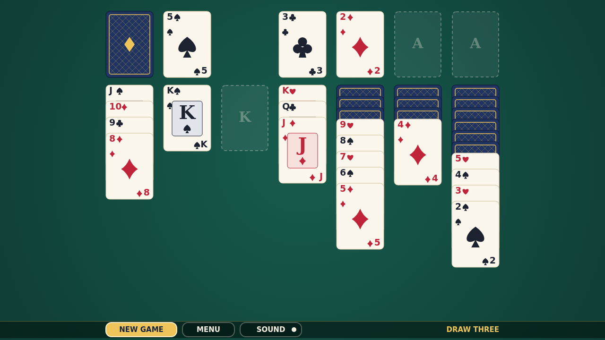

# Cascade

Cascade is Klondike solitaire on a deep green felt table, made for an unhurried
game in your browser. Twenty-eight cards are dealt into seven columns, with one
card turned up at the foot of each, and the rest wait face-down in the stock.
Your aim is to build all four foundations, one suit each, from Ace up to King.

Play is all in the pointer, and a mouse and a fingertip work just the same. Drag
a face-up card, and every card below it, onto a column that is one rank higher
and the other color. Only a King can take an empty column. Each card you uncover
turns face-up on its own. Click the stock to turn three cards onto the waste,
where only the front card plays. When the stock runs dry, click it again to
gather the waste back up, as many times as you like.

Double-click any card that is ready to go home and it jumps straight to its
foundation. When you want a fresh start, the bar along the bottom deals a new
game, takes you back to the menu, or turns the sound off.

Then there is the ending. The moment your last King lands, the table gives way:
one by one the cards leap off the foundations, arc across the felt, bounce along
the bottom edge, and leave a trail of themselves behind until the whole table is
buried in cards. Tap anywhere to deal again.
